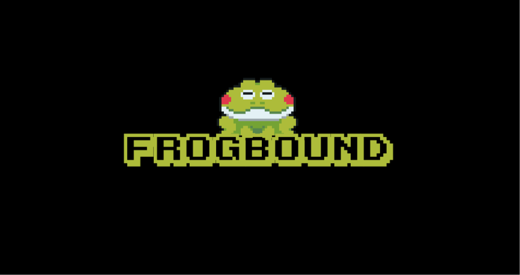

# FrogBound

FrogBound is a fast paced action game where you have to defeat waves of monsters, except each time, they bounce back even harder, in quantity and even size!!! 
Made with Godot :)

## Controls
- WASD or arrow keys to move
- SPACE/LMB to shoot

## Assets Used
- [Pixel Ninja Adventure](https://pixel-boy.itch.io/ninja-adventure-asset-pack) - Art
- [Pixelify Sans](https://fonts.google.com/specimen/Pixelify+Sans) - Font
- [Karmatic Arcade](https://www.1001fonts.com/karmatic-arcade-font.html) = Font
- [Burgers](https://opengameart.org/content/burgers) - Music
